# Li Xiang (李响) [v8.3 beta]

English | [中文](README.zh-CN.md)

## ▶ Now running

- Agent-native engineer @ Strategy (HUST CS): agents write the code, deterministic infrastructure — gates, notes, mechanical checks — holds the quality line
- Researching agent control-flow architectures, LLM inference & serving, GPU cluster scheduling
- Core stack: **Python / C** on **Kubernetes**; Rust, when it compiles

## ⚔ Quest log

| Quest | Description |
| --- | --- |
| [**govrail**](https://github.com/Lixiang9716/govrail) | A language-agnostic governance plane for agent-driven development: **gates** turn any checkable promise into a mechanical check, **notes** record every decision and the alternatives it beat. Published on [PyPI](https://pypi.org/project/govrail/) |
| [**devflow**](https://github.com/Lixiang9716/devflow) | An AI-driven structured software engineering multi-agent system: five-phase gate model (requirements → feasibility → architecture → implementation → verification). The LLM only reasons and decides; artifacts are produced by deterministic tools |
| [**LCode**](https://github.com/Lixiang9716/LCode) | A Rust-based terminal CLI code agent: autonomous planning, file read/write, command execution, with OpenAI / Anthropic backends |
| [**dsh-issue-bot**](https://github.com/Lixiang9716/dsh-issue-bot) | A DeepSeek Harness host plugin: watches new GitHub issues and auto-dispatches an agent to handle them. Built-in polling mode — no public IP required |

## 📡 Telemetry

All numbers are real: snapshotted from live GitHub data and self-hosted via GitHub Actions (no third-party image hosts).

| | |
| --- | --- |
|  |  |
|  |  |

**Bonus stage**: the snake is eating my contribution graph.

<picture>
  <source media="(prefers-color-scheme: dark)" srcset="https://raw.githubusercontent.com/Lixiang9716/Lixiang9716/output/github-snake-dark.svg" />
  <source media="(prefers-color-scheme: light)" srcset="https://raw.githubusercontent.com/Lixiang9716/Lixiang9716/output/github-snake.svg" />
  
</picture>

---

📫 Say hi: [issue](https://github.com/Lixiang9716/Lixiang9716/issues) / [discussion](https://github.com/Lixiang9716/Lixiang9716/discussions) / [1395734327@qq.com](mailto:1395734327@qq.com) — agent governance, LLM systems, or if you also commit at 03:00.

`CONTINUE? 9… 8… 7…`
