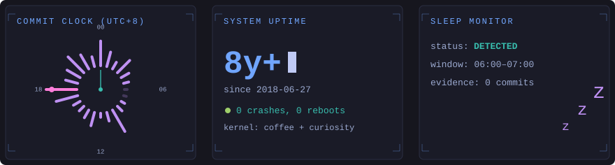
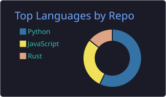
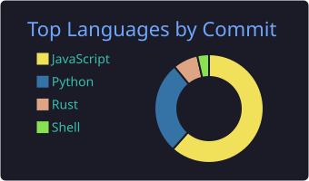
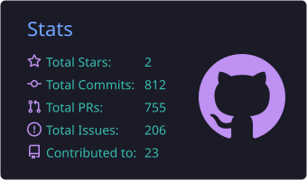
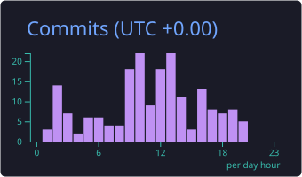

# 李响 (Li Xiang) [v8.3 beta]

[English](README.md) | 中文

## ▶ 正在运行

- Agent-native 工程师 @ Strategy(HUST CS):让 agent 写代码,用确定性基础设施——gates、notes、机械检查——守住质量线
- 研究兴趣:Agent 控制流架构、LLM 推理与 serving、GPU 集群调度
- 核心技术栈:**Python / C**,跑在 **Kubernetes** 上;Rust,能编译就行

## ⚔ 攻略记录

| 项目 | 简介 |
| --- | --- |
| [**govrail**](https://github.com/Lixiang9716/govrail) | 语言无关的 agent 驱动开发治理平面:**gates** 把任何可检查的承诺变成机械检查,**notes** 记录每个决策及其落选方案。已发布 [PyPI](https://pypi.org/project/govrail/) |
| [**devflow**](https://github.com/Lixiang9716/devflow) | AI 驱动的结构化软件工程多 Agent 系统:五阶段门禁模型(需求→可行性→架构→实现→验证),LLM 只负责推理与决策,产物由确定性工具生成 |
| [**LCode**](https://github.com/Lixiang9716/LCode) | Rust 实现的终端 CLI code agent:自主规划、读写文件、执行命令,支持 OpenAI / Anthropic 后端 |
| [**dsh-issue-bot**](https://github.com/Lixiang9716/dsh-issue-bot) | DeepSeek Harness 宿主插件:监听 GitHub 新 issue 自动派发 agent 处理,内置轮询模式,无需公网 IP |

## 📡 遥测数据

数字都是真的:来自 GitHub 实测数据的快照,由 GitHub Actions 每日自建刷新,不依赖任何第三方图床。

| | |
| --- | --- |
|  |  |
|  |  |

**隐藏关卡**:贪吃蛇正在啃我的提交格子。

<picture>
  <source media="(prefers-color-scheme: dark)" srcset="https://raw.githubusercontent.com/Lixiang9716/Lixiang9716/output/github-snake-dark.svg" />
  <source media="(prefers-color-scheme: light)" srcset="https://raw.githubusercontent.com/Lixiang9716/Lixiang9716/output/github-snake.svg" />
  
</picture>

---

📫 打个招呼:[issue](https://github.com/Lixiang9716/Lixiang9716/issues) / [discussion](https://github.com/Lixiang9716/Lixiang9716/discussions) / [邮箱](mailto:1395734327@qq.com)——聊聊 agent 治理、LLM 系统,或者凌晨三点提交代码这件事。

`CONTINUE? 9… 8… 7…`
