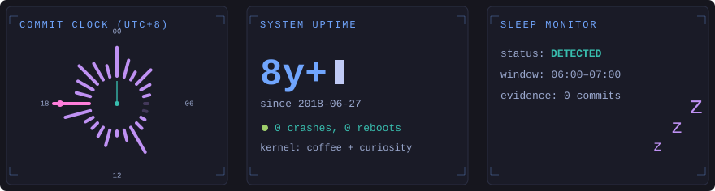

# 李响 (Li Xiang)

[English](README.md)

## ⚡ 攻略记录

| | |
| --- | --- |
| [**def**](https://github.com/Lixiang9716/def) 📌 | DSH 生态移动端宿主:QuickJS 单线程协程运行时,插件契约,UI 亦是插件 |
| [**govrail**](https://github.com/Lixiang9716/govrail) | agent 驱动开发的治理门禁,已上 [PyPI](https://pypi.org/project/govrail/) |
| [**dsh-issue-bot**](https://github.com/Lixiang9716/dsh-issue-bot) | GitHub issue 进,自主 agent 出 |

## 📡 遥测

真实数据,GitHub Actions 每日自建

## 🐍 隐藏关卡

<picture>
  <source media="(prefers-color-scheme: dark)" srcset="https://raw.githubusercontent.com/Lixiang9716/Lixiang9716/output/github-snake-dark.svg" />
  <source media="(prefers-color-scheme: light)" srcset="https://raw.githubusercontent.com/Lixiang9716/Lixiang9716/output/github-snake.svg" />
  
</picture>

---

`CONTINUE? 9… 8… 7…`

📫 [邮件](mailto:1395734327@qq.com) / [issue](https://github.com/Lixiang9716/Lixiang9716/issues) / [discussion](https://github.com/Lixiang9716/Lixiang9716/discussions)
